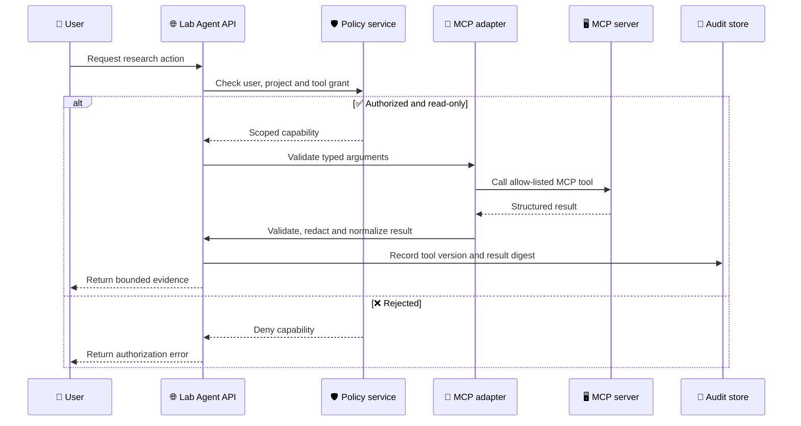
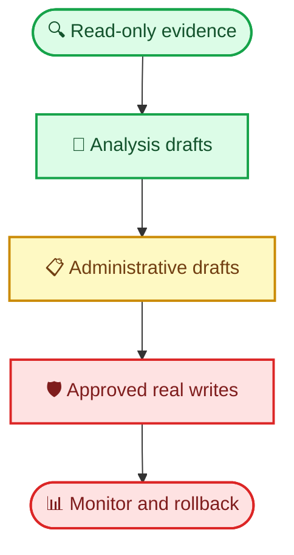

# Agent 平台教程落地与完整指南

_以 `lab-agent/` 当前代码为准：将根目录教程的六阶段思路映射到可运行的科研助手，并明确已实现能力、刻意未实现能力和生产扩展顺序。_

---

## 🧭 结论与适用范围

根目录的[《agent平台开发与维护》](../../docs/agent平台开发与维护.md)描述的是一个从零搭建通用 Agent 平台的六阶段路径；本仓库的根项目则是 Agent Skills 插件集合，实际可运行的应用在 `lab-agent/`。因此，本次落地以 `lab-agent` 为目标，而不是给根插件强行加入一个新的聊天平台。

当前项目已经实现了一个更适合科研场景的最小闭环：用户在项目授权范围内提问，模型（可选）只能选择服务端注册的低风险工具，服务端再独立执行 ACL、参数和引用校验，最后返回带定位信息的证据化回答。没有配置模型时，系统仍以确定性检索和候选查询生成工作，便于本地教学、测试和离线验收。

> ⚠️ **真实边界：** 当前代码未接入 Redis 会话、MCP 客户端、向量长期记忆、生产级 OIDC/SSO 或多 Agent 协作。它们不能被描述为“已完成”；本指南将其列为有前置条件的生产扩展，而非本地演示的必需依赖。

## 🗺️ 从教程到项目的映射

| 原教程阶段 | 当前落地点 | 状态 | 为什么这样落地 |
| --- | --- | --- | --- |
| 1. 单 Agent + 单工具 | `app/services/agent.py` 的 `AgentService` | 已实现，且扩展为两个只读/低风险工具 | 科研问答首先需要受控证据检索；服务端白名单比让模型调用任意函数更安全 |
| 2. Redis 会话管理 | 本地 `LocalArchive`、工作流 checkpoint 与本地 SQLite | 本地替代；Redis 未接入 | 教学演示必须无外部依赖且可重复；横向扩展前再引入 Redis |
| 3. MCP 工具集成 | 服务端原生工具契约：`_tools()` 与 `_execute_tool()` | 已采用等价的受限接口；MCP 未接入 | 工具本身少且涉及 ACL，先将授权收口在应用服务层，避免把权限边界外包给协议适配层 |
| 4. 三层记忆 | 已有授权归档检索、工作流状态和审计；没有跨会话“用户记忆” | 部分实现 | 科研证据须可追溯且有项目 ACL；未经治理的偏好/对话记忆会造成串项目泄漏 |
| 5. Prompt 迭代与评测 | `tests/evals/knowledge_cases.jsonl`、`release-check`、`launch-report` | 已实现基础门禁 | 先把授权、无证据、引用与恶意输入作为可回归契约，再优化模型表达 |
| 6. 组装完整系统 | FastAPI、React、本地归档、论文工作流与发布检查 | 已实现本地可运行系统 | 先提供确定性、可验收的闭环；外部写入留给审批状态机，而不交给模型 |

## 🏗️ 当前架构与请求闭环

下面是本次核对后确认的实际调用链。模型只提交“选择哪个工具、带什么结构化参数”的意图；它不是权限判断、写入或审批的执行者。

```mermaid
flowchart LR
    accTitle: Lab Agent Evidence Flow
    accDescr: A user request is authorized by FastAPI, optionally routed through a restricted model tool loop, checked by server-owned services, and returned as an evidence-grounded answer without model-controlled writes.

    user([👤 Project user]) --> api[🌐 FastAPI endpoint]
    api --> identity{🔐 Project visible?}
    identity -->|No| denied([🛡️ Return 403])
    identity -->|Yes| agent[🖥️ AgentService]
    agent --> model{⚙️ Model configured?}
    model -->|No| fallback[🔍 Deterministic fallback]
    model -->|Yes| tools[🔌 Restricted tool loop]
    tools --> server_checks[🛡️ Server validates tool, role and arguments]
    server_checks --> archive[(💾 ACL-first LocalArchive)]
    fallback --> archive
    archive --> citations[📝 Validated citations]
    citations --> response([📤 Evidence-bound answer])

    classDef action fill:#dbeafe,stroke:#2563eb,stroke-width:2px,color:#1e3a5f
    classDef decision fill:#fef9c3,stroke:#ca8a04,stroke-width:2px,color:#713f12
    classDef guard fill:#fee2e2,stroke:#dc2626,stroke-width:2px,color:#7f1d1d
    classDef result fill:#dcfce7,stroke:#16a34a,stroke-width:2px,color:#14532d

    class api,agent,fallback,tools,server_checks,archive,citations action
    class identity,model decision
    class denied guard
    class user,response result
```



### 当前服务与职责

| 组件 | 代码位置 | 做什么 | 为什么必须由服务端控制 |
| --- | --- | --- | --- |
| HTTP 入口 | `app/main.py` | 解析请求、解析本地演示用户、检查项目可见性、提供 SSE | 浏览器传来的身份和角色不能直接作为权限事实 |
| Agent 工具循环 | `app/services/agent.py` | 只注册证据检索与候选文献查询；最大三轮 | 防止模型得到审批、写入、ACL 或任意命令工具 |
| 授权策略 | `app/core/authz.py` | 按活动状态、项目角色、ACL 和工具白名单决定访问 | 提示词不是安全边界，必须有可测试的确定性策略 |
| 证据知识库 | `app/services/knowledge.py`、`app/services/local_archive.py` | 在授权文档内检索、构建并验证引用 | 回答只能引用本轮实际检索到的片段，不能由模型伪造 ID |
| 高风险动作 | `app/services/admin_adapter.py`、`app/services/manuscript_workflow.py` | 预览、审批、确认、幂等提交和人工审核状态机 | 有副作用的操作需要显式确认和可审计状态迁移 |
| 发布门禁 | `app/release_check.py`、`app/launch_report.py` | 运行测试、静态检查、红队输入、预算和上线顺序检查 | 用可重复检查替代“感觉已经能上线” |

## 🧪 阶段一：单 Agent 与受限工具调用

### 已经做了什么

这一阶段的目标不是让模型拥有系统权限，而是完成“用户请求 → 模型选择白名单工具 → 服务端校验并执行 → 返回可验证结果”的最小闭环。现有代码已经实现了这四步；下面按实现顺序说明具体要写什么。

#### 1. 定义固定的输入、输出与轮数上限

在 `app/services/agent.py` 中定义 Agent 输出模型和执行上限。`AgentRun` 让 API 响应始终包含回答、实际执行过的工具、引用、是否使用模型及最终状态；`MAX_TOOL_ROUNDS` 防止模型无限调用工具。

```python
MAX_TOOL_ROUNDS = 3
MAX_EVIDENCE_CHUNKS = 5


class AgentRun(BaseModel):
    run_id: str = Field(default_factory=lambda: str(uuid.uuid4()))
    answer: str
    citations: list[Citation] = Field(default_factory=list)
    candidate_query: str | None = None
    executed_tools: list[str] = Field(default_factory=list)
    model_used: bool
    status: str
    max_tool_rounds: int = MAX_TOOL_ROUNDS
```

需要做的事：新增能力前，先决定它是否是只读能力、最大返回量、最大调用轮数和 API 输出字段。不要先写 Prompt 再补限制，因为 Prompt 只能影响模型行为，不能替代程序限制。

#### 2. 在服务端注册工具 schema

`AgentService._tools()` 是模型唯一可见的工具目录。当前注册两个工具：

1. `search_authorized_evidence`：在当前用户可读的项目文档中检索证据。
2. `propose_literature_query`：为有 `research-assistant` 或 `pi` 项目角色的用户生成候选 Europe PMC 查询。

每个工具用 JSON Schema 限制字段名、类型和长度，例如证据检索工具：

```python
{
    "type": "function",
    "function": {
        "name": "search_authorized_evidence",
        "description": "Search only evidence the current user is authorized to read.",
        "parameters": {
            "type": "object",
            "properties": {
                "query": {"type": "string", "minLength": 1, "maxLength": 1000}
            },
            "required": ["query"],
            "additionalProperties": False,
        },
    },
}
```

需要做的事：新增一个低风险工具时，在 `_tools()` 增加一个固定 schema；参数应尽可能窄，例如枚举、长度和数值上限都写在 schema 中。不要让模型提供 URL、文件路径、Shell 命令、SQL 或“任意工具名称”。审批、导入、删除、权限变更和真实外部提交不能加入此列表。

#### 3. 由服务器执行工具，并再次验证授权与结果

工具 schema 只约束模型输出格式，不能证明模型有权执行。因此 `_execute_tool()` 必须按工具名分支，重新校验参数和权限，并调用服务端业务服务。证据检索的关键代码如下：

```python
if name == "search_authorized_evidence":
    query = arguments.get("query")
    if not isinstance(query, str) or not query.strip() or len(query) > 1000:
        return {"error": "invalid evidence query"}, [], None

    retrieved = self.knowledge.search_documents(
        user["id"], query.strip(), project_id, MAX_EVIDENCE_CHUNKS
    )
    citations = [
        Citation(document_id=item["document_id"], chunk_id=item["id"], title=item["title"])
        for item in retrieved
    ]
    validate_citations(citations, retrieved)
    return {"evidence": [...]}, citations, None
```

候选检索式工具还要调用 `can_execute_tool()`：

```python
if not can_execute_tool(user, "agent.propose_literature_query", project_id):
    return {"error": "candidate query generation requires research-assistant or pi role"}, [], None
```

需要做的事：每个新工具都要在 `_execute_tool()` 中实现对应分支，并至少完成参数校验、项目范围校验、角色/工具授权、超时与返回数据限制。对检索结果要由服务器生成引用并验证；对有副作用的动作只能返回预览或候选值，真正写入要交给独立的确认和审批 API。

#### 4. 将工具循环接入模型与 HTTP API

`AgentService.run()` 将系统提示词、用户请求和 `_tools()` 发送给兼容 OpenAI function-calling 的模型。第一次调用使用 `tool_choice="required"`，强制模型先取得服务端证据；后续调用才允许 `"auto"`。服务端解析每次 `tool_calls`，调用 `_execute_tool()`，再把受控结果作为 `role="tool"` 消息返回给模型。

```python
for _ in range(MAX_TOOL_ROUNDS):
    completion = self.model_client.chat.completions.create(
        model=model_name,
        messages=messages,
        tools=self._tools(),
        tool_choice="required" if not executed_tools else "auto",
    )
    for call in completion.choices[0].message.tool_calls or []:
        arguments = json.loads(call.function.arguments)
        result, new_citations, query = self._execute_tool(
            user, project_id, call.function.name, arguments
        )
        messages.append({
            "role": "tool", "tool_call_id": call.id,
            "content": json.dumps(result, ensure_ascii=False),
        })
```

最后，在 `app/main.py` 使用 `POST /v1/agent/run` 接收 `project_id`、`request` 与 `mode`，由 `current_user()` 获取服务器拥有的用户上下文，先检查项目可见性，再调用 `AgentService.run()`：

```python
@app.post("/v1/agent/run", response_model=AgentRun)
def run_agent(request: AgentRequest, x_user_id: str | None = Header(default=None)) -> AgentRun:
    user = current_user(x_user_id)
    if request.project_id not in user["project_roles"] and "admin" not in user["roles"]:
        raise HTTPException(status_code=403, detail="project is not visible to this user")
    return AgentService(KnowledgeService(_archive())).run(
        user, request.project_id, request.request,
        prefer_candidate_query=request.mode == "literature_query",
    )
```

未设置 `LAB_AGENT_OPENAI_MODEL` 时，代码进入 `_fallback()`：知识问题仍通过授权检索回答，候选查询仍由受控规则生成。这样本地演示、单元测试和模型供应商故障时都不会因为缺少模型而停止工作。

这样实现比教程中的“天气工具”多了三层关键保护：授权检索只返回可见证据、服务器创建并验证引用、候选文献查询不执行下载或入库。

### 如何运行与验证

```bash
cd /GIT/scientific-agent-skills/lab-agent
./scripts/start-local.sh
```

在另一个终端验证本地降级路径：

```bash
curl --fail --silent -X POST http://127.0.0.1:8000/v1/agent/run \
  -H 'Content-Type: application/json' \
  -H 'X-User-Id: research-demo' \
  --data '{"project_id":"mouse-neuro-demo","request":"小鼠海马神经发生与阿尔茨海默病","mode":"literature_query"}'
```

预期返回 `candidate_query`，`executed_tools` 为 `propose_literature_query`，且未配置模型时 `model_used` 为 `false`。启用模型是可选项，配置应只存在于运行环境：

```bash
export OPENAI_API_KEY='your-api-key'
export LAB_AGENT_OPENAI_MODEL='your-tool-calling-model'
```

不要把密钥、模型地址或供应商专有配置写入代码、Markdown 示例的真实值或浏览器包。

## 💾 阶段二与四：状态、会话和记忆

### 当前实现为何不直接加入 Redis

教程使用 Redis 保存会话、用乐观锁避免并发覆盖；这是多实例在线服务的合理做法。但当前 `lab-agent` 的目标是离线可运行的科研教学应用：默认不需要 Redis、PostgreSQL、对象存储或模型 API。其当前状态分工是：

| 状态类型 | 当前保存位置 | 当前用途 | 安全约束 |
| --- | --- | --- | --- |
| 授权文档、片段、ACL、审计 | `LocalArchive` 的本地 SQLite 与对象副本 | 项目内知识检索与证据定位 | 所有检索先按用户、项目和角色过滤 |
| 论文流程状态与产物 | `ManuscriptWorkflow` 根目录 | 检索计划、证据表、草稿、人工审核 | 显式状态机，不允许跳过审核节点 |
| 教学用 checkpoint | `CheckpointStore` | 测试恢复语义 | 仅内存示例，不是持久化生产实现 |
| 幂等键 | `LocalAdminAdapter` 的 SQLite 表 | 避免模拟外部提交重复执行 | 数据库唯一约束而非仅依赖进程内锁 |
| 对话长期偏好 | 未实现 | 不保存 | 避免跨用户或跨项目记忆泄漏 |

这相当于优先实现“项目证据记忆”，而不是把所有聊天内容作为长期记忆。对于科研场景，这是更保守也更可审计的选择：证据有来源、项目边界与引用；用户偏好或自由对话一旦跨项目复用，容易带来授权与隐私问题。

### 生产化扩展方案

当部署目标变为多副本、长会话的在线服务后，按以下顺序接入 Redis，而不要替换现有授权存储：

1. 用键 `session:{tenant}:{project}:{user}:{session_id}` 保存短期会话和 TTL；键必须包含租户、项目和用户边界。
2. 对会话版本使用 `WATCH`/`MULTI` 或 Lua 脚本实现 compare-and-set，冲突时重读并重试；不可无条件覆盖整个状态。
3. 只在 Redis 存放会话摘要、游标和短期消息，不存 API 密钥、完整敏感原文或未经授权的检索结果。
4. 每次从缓存恢复的文档 ID、工具能力和角色都重新经过服务端授权；缓存命中不能绕过 ACL。
5. 将持久任务 checkpoint 放入带唯一任务 ID 的数据库记录或对象存储，并记录版本、输入摘要、执行人和恢复原因。

> 📌 **记忆准入规则：** 只有带所有者、项目、分类、来源和保留期的事实才可进入长期存储；模型的自由总结不是默认可信事实。删除项目成员、角色变更或文档撤销后，应让其相关缓存/记忆立即失效。

## 🔌 阶段三：外部工具与 MCP 的正确接入点

当前项目的工具契约是 OpenAI function-calling 结构；它已经提供了 MCP 所追求的“模型按 schema 发出工具意图”的核心效果，但权限仍在 `AgentService` 和 `authz.py`。这里刻意未连接教程提到的公共 MCP Server 或网关。

原因是：MCP 解决工具发现与传输，不自动解决项目 ACL、工具最小权限、引用真实性、审批或审计。对于能访问文献、实验或行政数据的科研应用，先把工具收敛为本地服务端能力是正确起点。

需要加入 MCP 时，建议采用下面的适配边界：



实施时，为每个外部工具建立一个服务端适配器，而非把 MCP 的全部工具列表直接转交给模型。适配器应固定允许的工具名、参数 schema、超时、最大响应字节数、数据分类与审计字段；写工具还必须走“预览 → 独立人工确认 → 幂等提交”的路径。

## 📏 阶段五：Prompt、评测与发布门禁

### 当前已有的可执行质量控制

本项目没有采用 `evx`，但已经具备更贴近当前代码的最小评测与发布闭环：

| 控制项 | 实现 | 验证的风险 |
| --- | --- | --- |
| 评测语料 | `tests/evals/knowledge_cases.jsonl` | 授权回答、无证据、跨项目、无权限、引用绑定、恶意提示文本等 |
| Agent 单元测试 | `tests/test_agent.py` | 降级检索、模型只能看见两个注册工具、没有审批工具 |
| API 测试 | `tests/test_api.py` | 请求身份和 Agent API 的边界 |
| 输入防护 | `validate_tool_arguments()` | 路径穿越、SQL/Shell 片段、超大参数 |
| 资源预算 | `BudgetController` | 达到步骤、token、成本或截止时间后停止 |
| 发布报告 | `launch-report` | 聚合测试、Ruff、红队样本、金额阈值与最小权限上线顺序 |

运行完整本地验收：

```bash
cd /GIT/scientific-agent-skills/lab-agent
.venv/bin/python -m pytest -q
.venv/bin/python -m ruff check app tests
.venv/bin/python -m app.cli release-check
.venv/bin/python -m app.cli launch-report \
  --json-output launch-readiness.json \
  --markdown-output launch-readiness.md
```

最后一条会生成本地报告文件；它们是运行产物，不应提交。只有报告为 `Ready: True` 且测试、静态检查均成功，才说明当前这组本地门禁通过。

### 下一步如何真正评测 Prompt

现有 `launch-report` 只检查评测 case 数量不少于 30，并不逐条运行模型后计算通过率。因此不要把它误称为自动 Prompt 优化。若启用模型并修改系统提示词，建议在不破坏现有确定性回归的前提下补齐：

1. 为每个 case 增加断言字段：期望工具、禁止工具、最低引用数、允许状态及人工判定标签。
2. 使用固定模型版本、固定温度和脱敏测试语料，逐条执行 Agent，保存 run ID、提示词版本、工具轨迹与结果摘要。
3. 分开报告授权安全通过率、引用正确率、任务完成率、拒答正确率、延迟和成本；不能只报告“回答看起来不错”。
4. 将候选 Prompt 与基线在同一评测集上比较；安全指标下降、成本越界或出现禁止工具时，即使文风更好也不得接受。
5. 保留人工盲审，特别检查引用是否支持结论、是否过度概括、是否把无证据说成否定结论。

## 🚀 阶段六：完整运行教程

### 本地最小闭环

1. 进入应用目录并启动：`cd lab-agent && ./scripts/start-local.sh`。
2. 在浏览器打开 `http://127.0.0.1:8000`，使用默认的 `Research Assistant Demo` 身份进行知识问答。
3. 在“研究方向助手”中生成候选检索式；先检查页面显示的查询，再显式确认导入开放获取文献。
4. 核验回答的 `citations` 定位信息；没有授权证据时应得到 `insufficient_evidence`，而不是编造答案。
5. 对报销或论文流程只使用页面/CLI 的审批状态机；不要试图通过模型提示词越过确认步骤。
6. 在变更工具、授权、检索、提示词或工作流后，运行上一节的回归与发布检查。

### 从本地到生产的上线顺序

生产能力应按风险递增，而不是按“Agent 自主程度”递增：



每一步开始前都应满足前一步的评测、审计、预算、访问控制与回滚要求。特别是“真实写入”前必须补齐已验证的 OIDC 身份、服务端策略源、事务性幂等键、外部系统状态查询、告警和人工责任人。

## 🔒 本次实际完成内容与原因

本次没有为了匹配教程而新增运行时依赖或改动 Agent 行为；完成的是一次基于代码和现有文档的落地梳理，并新增本文件作为该项目的完整教程。

| 完成项 | 结果 | 原因 |
| --- | --- | --- |
| 确认教程落地点 | 选择 `lab-agent/`，而非根 `skills/` 插件 | `lab-agent` 才是本仓库已有的可运行 Agent 应用 |
| 对照六阶段 | 标识每阶段的已实现、部分实现与未实现状态 | 防止将教程建议误报为项目事实 |
| 梳理安全架构 | 记录白名单工具、ACL、引用校验、审批和幂等边界 | 科研数据和外部写入的风险高于通用聊天演示 |
| 写入可执行教程 | 提供启动、API 验证、测试、发布检查和生产扩展顺序 | 使维护者可从文档复现而非只阅读设计描述 |
| 保持实现范围 | 未添加 Redis、MCP、向量记忆或多 Agent | 这些需要明确的部署、数据治理和安全需求，不能作为文档任务的隐式副作用 |

## ✅ 维护者检查清单

- [ ] 新工具是否在服务端白名单中注册，而不是由用户输入动态决定
- [ ] 每次工具调用是否重新校验用户、项目、角色、参数和数据分类
- [ ] 每个回答的引用是否都来自本轮已授权检索结果
- [ ] 所有写操作是否经过预览、确认、审批、幂等和审计
- [ ] 模型、工具、检索或授权变动后，是否扩展了回归评测案例
- [ ] 上线前是否运行测试、Ruff、`release-check` 与 `launch-report`
- [ ] 引入 Redis、MCP 或长期记忆前，是否已有明确的数据保留、ACL 失效、审计和回滚设计

## 🔗 代码与延伸阅读

- [原始六阶段教程](../../docs/agent平台开发与维护.md)
- [完整本地使用手册](完整使用手册.md)
- [受限工具调用 Agent 教程](第十四章受限工具调用Agent教程.md)
- [Agent 服务](../app/services/agent.py)
- [授权策略](../app/core/authz.py)
- [发布报告](../app/launch_report.py)
- [评测案例](../tests/evals/knowledge_cases.jsonl)
